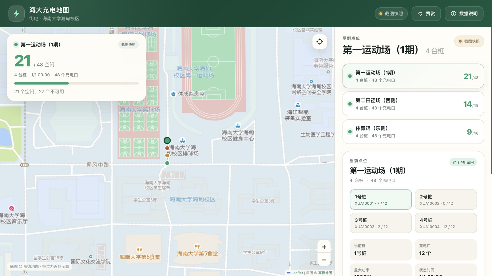

# 海大充电地图

海南大学海甸校区共享充电桩实时状态地图。一个面向校园场景的小型 Web 应用：Python 标准库后端 + 原生前端 + Leaflet，抓取街电小程序扫码接口，按充电口展示实时占用情况。



线上站点：<https://hnuebikecharge.xyz/guest/>（使用真实采集数据）

> 为避免公开真实桩位，**本仓库内置的是示例数据**：3 个示例站点、12 台桩，桩码、坐标和端口状态均为占位值。线上站点的真实数据不会随仓库发布；复现时请采集你自己的二维码，按 `docs/DEPLOY.md` 替换。

## 功能

- **多站点**：第一运动场（1期）、第二田径场（西侧）、体育馆（东侧）；线上站点共 58 台桩、696 个充电口，仓库内置 3 个示例站点、12 台桩
- **实时状态**：每 60 秒轮询接口，逐个充电口显示空闲 / 不可用；接口异常或 token 过期时自动回退到截图快照
- **接口充电时长**：登录页可开关，显示当前选中桩 12 个接口各自的已充电时长，空闲接口显示“空闲”（从本站首次监测到占用开始计时；`/guest/` 不显示）
- **接口异常标记**：同一接口 24 小时内出现 3 次以上“短时占用（≤10 分钟）后恢复空闲”，会在端口格子上用紫色“异常”标记；登录页和 `/guest/` 都会显示
- **桩位地图**：Leaflet + 高德底图，所有桩位常驻显示；点击桩号或地图圆点会放大到该桩，并显示上宽下窄的指示牌，避免遮挡下方桩位
- **站点切换**：左侧站点列表带空闲统计，切换时自动缩放到该站点的桩位范围
- **两种访问**：主站用 Basic Auth 保护，`/guest/` 路径免登录，适合分享给同学查看
- **移动端适配**：响应式布局，手机浏览器可直接使用
- **赞赏与反馈**：页脚内置赞赏弹窗（微信收款码）和反馈邮箱，可按需删除

## 技术栈

| 层 | 选型 |
|---|---|
| 后端 | Python 3.8+ 标准库（`ThreadingHTTPServer` + `urllib`），无第三方依赖 |
| 前端 | 原生 JavaScript、CSS，Leaflet 1.9（`vendor/` 内置） |
| 反向代理 / HTTPS | Caddy 2（自动申请 Let's Encrypt 证书） |
| 进程管理 | systemd |
| 数据源 | `union.zhumanggroup.com/api/rent/scan-code`（街电小程序接口） |
| 地图底图 | 高德瓦片，本地缓存；仓库不包含瓦片文件（版权原因） |

## 架构

```
浏览器 / 手机
      │ HTTPS
      ▼
   Caddy :443
      ├── /guest/*        免登录，反代到 127.0.0.1:8791
      └── 其他路径         Basic Auth 后反代到 127.0.0.1:8791
                │
                ▼
      Python (127.0.0.1:8791)
        ├── 静态文件：index.html / assets / tiles
        └── /api/status：并发请求街电接口，60 秒缓存
                          （token 只放在服务器环境变量里）
```

## 目录结构

```
hnu-charge-map/
├── index.html                 页面结构与弹窗
├── server.py                  静态文件服务 + 街电接口代理 /api/status
├── assets/
│   ├── app.js                 地图、站点/桩位交互、实时数据合并
│   ├── config.js              地图中心、缩放、轮询间隔等
│   ├── data.js                站点与桩位静态数据（含 GPS 快照）
│   ├── styles.css
│   ├── favicon.svg
│   └── tip-qr.png             赞赏收款码（可替换为自己的）
├── deploy/
│   ├── bootstrap.sh           首次安装脚本（Ubuntu）
│   ├── hnu-charge-map.service systemd 服务单元
│   ├── Caddyfile.domain       域名 + 自动 HTTPS 的 Caddy 配置示例
│   ├── Caddyfile.temp         自签证书 + 8443 的临时配置
│   ├── setup-tls.sh           生成自签 IP 证书
│   └── update-token.sh        交互式更新街电 token
├── docs/
│   ├── DEPLOY.md              完整复现 / 部署 / 新增点位指南
│   ├── AI-PROMPT.md           交给 AI 部署时的提示词模板
│   └── screenshot.jpg
├── tools/
│   ├── qr-gps.swift           macOS 批量识别二维码并读取照片 GPS
│   └── wgs2gcj.py             WGS-84 → GCJ-02 并生成桩位数据
├── tiles/                     底图瓦片缓存（不入库，需自行提供）
└── vendor/leaflet/            Leaflet 1.9（BSD-2-Clause）
```

## 本地运行

只需要 Python 3.8+：

```bash
python3 server.py --host 127.0.0.1 --port 8791
```

打开 <http://127.0.0.1:8791/>。不配置 token 时，页面显示 `data.js` 里的示例快照数据（3 个站点、12 台桩）。

要启用实时数据，把街电小程序的 `Authorization` token 放进环境变量：

```bash
export ZHUMANG_TOKEN='eyJ...'
python3 server.py --host 127.0.0.1 --port 8791
```

token 获取方式与有效期说明见 [docs/DEPLOY.md](docs/DEPLOY.md)。

## 部署

完整步骤（服务器、DNS、systemd、Caddy、HTTPS、Basic Auth、备案注意事项）见 **[docs/DEPLOY.md](docs/DEPLOY.md)**。

简要流程：

1. Ubuntu 22.04/24.04 服务器，安装 `python3`、`caddy`
2. 代码放到 `/opt/hnu-charge-map`，用 systemd 跑 `server.py --host 127.0.0.1 --port 8791`
3. 域名 A 记录指向服务器，Caddy 自动签发证书
4. `deploy/update-token.sh` 写入 token，页面开始显示实时数据
5. 防火墙放行 80/443，按需给主站加 Basic Auth

## 用 AI 复现

这个仓库可以直接交给能操作服务器的 AI：你提供服务器、域名、token 和现场拍的二维码照片，AI 按 [`docs/DEPLOY.md`](docs/DEPLOY.md) 部署并替换示例数据。提示词模板见 [`docs/AI-PROMPT.md`](docs/AI-PROMPT.md)。

## 数据说明与限制

- **仓库内**的桩位编码、坐标和端口状态是示例占位值，不代表任何真实充电桩
- **线上站点**的真实桩位来自现场逐台拍摄的二维码照片；坐标由照片 GPS 换算为高德 GCJ-02 后做了直线化 / 等距整理，**只表示大致相对位置，不是精确测绘结果**
- 接口返回的 `status` 取值含义（0=空闲，1/2=不可用）是根据小程序端口页颜色反推的，平台没有公开文档
- token 是微信小程序登录态，通常 7 天左右失效，目前需要手动更新；token 过期时页面自动回退到截图快照
- 底图来自高德地图；仓库**不包含**瓦片缓存文件，请使用已获授权的方式提供底图，或自行修改 `assets/config.js` 中的 `tileUrl`
- 本项目与街电、海南大学无隶属关系，数据版权归原平台所有

## 新增点位

1. 用手机逐台拍摄桩上的二维码，确保照片保留 GPS 信息、且拍摄时站在桩旁
2. 在 macOS 上运行 `tools/qr-gps.swift` 批量提取二维码与坐标
3. 用 `tools/wgs2gcj.py` 转换为 GCJ-02 并生成数据条目
4. 把桩位写入 `assets/data.js` 的 `stations`，同时在 `server.py` 的 `DEVICES` / `STATIONS` 里登记
5. 重启服务，用 `/api/status` 确认新桩返回数据

详细命令和注意事项见 [docs/DEPLOY.md](docs/DEPLOY.md#新增点位)。

## 已知限制

- 没有数据库，所有桩位与快照都在 `data.js` 里，适合几十台桩的规模
- token 无法自动续期，需要人工重新抓取
- 单实例部署，未做接口限流与多用户鉴权
- 中国大陆服务器上的域名需要 ICP 备案；未备案时 80/443 可能被云厂商拦截（本项目曾用非标准端口 + 自签证书作为过渡）
- 高德瓦片、街电接口均有各自的使用条款，请自行确认合规性

## 安全与隐私

- 街电 token 只保存在服务器 `/etc/hnu-charge-map.env`（权限 600），不会进入前端
- 主站启用 Basic Auth；`/guest/` 仅暴露只读的桩位状态
- 项目不收集访问者信息，没有统计脚本和第三方追踪
- 服务器仅开放 22 / 80 / 443（按需），Python 只监听 `127.0.0.1`

## 免责声明

本项目为学生自主开发的学习项目，仅供个人学习、校园内非商业使用。请勿用于大规模抓取、商业转售或任何违反平台条款和学校规定的用途。因使用本项目产生的数据准确性、服务可用性和合规问题由使用者自行承担。

代码未附开源许可证；如需复用、二次开发或商用，请先联系作者。

## 致谢

- [Leaflet](https://leafletjs.com/)（BSD-2-Clause）
- 高德地图底图
- 街电小程序（数据来源）
- [Caddy](https://caddyserver.com/)

## 反馈

邮箱：<a461589871@icloud.com>
